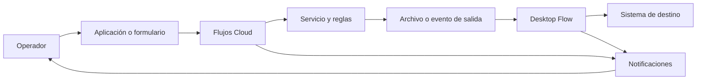

# Harness de ingeniería para automatizaciones multi-sistema

Este harness convierte una automatización entre aplicaciones en una implementación repetible. Separa contratos, configuración local, pasos manuales, comandos de despliegue y evidencia de una ejecución real. Se puede reutilizar cuando un proceso combine una aplicación de negocio, un servicio, almacenamiento, automatización de escritorio y avisos al operador.



## Qué contiene

| Elemento | Uso |
| --- | --- |
| [`templates/process-profile.example.json`](templates/process-profile.example.json) | Declara componentes e identificadores que cambian por proceso. No contiene secretos. |
| [`templates/implementation-checklist.md`](templates/implementation-checklist.md) | Distingue tareas manuales, automatización por consola y evidencia E2E. |
| [`templates/acceptance-record.md`](templates/acceptance-record.md) | Registra cada tramo y evita aceptar estados vacíos. |
| [`reference-auto-tasacion.md`](reference-auto-tasacion.md) | Referencia concreta de esta implementación, incluidos los problemas resueltos. |
| [`../../tools/New-ProcessHarness.ps1`](../../tools/New-ProcessHarness.ps1) | Crea una carpeta de proceso a partir de las plantillas. |

## Cómo iniciar otro proceso

Desde la raíz del repositorio:

```powershell
Set-ExecutionPolicy -Scope Process -ExecutionPolicy Bypass -Force
.\tools\New-ProcessHarness.ps1 `
  -ProcessKey <proceso-en-kebab-case> `
  -DisplayName '<Nombre visible del proceso>'
```

Se crea `docs/processes/<proceso>/` con `process-profile.json`, `implementation-checklist.md` y `acceptance-record.md`.

Complete primero el perfil. Los valores opacos de conexiones, carpetas, chats, cuentas y secretos se crean o descubren en cada entorno; nunca se copian desde otro proceso ni se incorporan al repositorio.

## Secuencia de implementación

| Fase | Resultado | Responsable principal |
| --- | --- | --- |
| 1. Contrato | Entradas, salidas, estados terminales, llave de correlación y datos prohibidos definidos. | Dueño del proceso + integración. |
| 2. Preparación manual | Aplicación, carpetas, conexiones, secreto montado, alertas y Desktop Flow configurados. | Administradores de cada plataforma. |
| 3. Despliegue automatizado | Definiciones reproducibles publicadas por scripts, con plan antes de activar. | Implementador autorizado. |
| 4. Prueba E2E | Una llave de prueba atraviesa cada frontera y deja evidencia. | Operador + implementador. |
| 5. Operación | Alertas, idempotencia, diagnóstico y reversa disponibles. | Operación. |

## Reglas reutilizables

- Cada lote o caso tiene una llave de correlación estable desde la entrada hasta la alerta final.
- Los secretos permanecen en Secret Manager o en conexiones de plataforma. Los scripts pueden leerlos durante el despliegue, pero no los escriben en archivos ni consola.
- Todo comando de cambio tiene primero un modo de lectura o plan y después una acción explícita de activación.
- Los eventos repetidos deben ser idempotentes. Un reintento no puede duplicar una operación de escritorio ni una transacción de negocio.
- Las alertas contienen identificador, etapa, estado y siguiente acción. No incluyen documentos, datos personales, valores de negocio ni detalles técnicos que deban quedar en el registro seguro.
- Un tramo se acepta solo cuando su salida esperada está presente y no vacía. Una alerta final emitida con campos vacíos requiere corregir o validar el mapeo de salidas antes del cierre.

- En automatización de terminales, modele cada pantalla intermedia comprobada. No fuerce coordenadas si el host ya posiciona el cursor en el campo editable.
- Separe abrir, autenticar y preparar sesión de la operación de negocio. Si otro cliente toma el control después, libere el manejador de terminal sin cerrar la aplicación que debe permanecer abierta.
- Registre las acciones deshabilitadas como configuración pendiente, no como capacidad operativa. Una falla funcional debe devolver un estado de error observable, nunca un éxito técnico.
- Las configuraciones compartidas solo pueden contener parámetros no sensibles; las contraseñas se obtienen desde un almacén seguro en tiempo de ejecución.
- Cuando el resultado detallado existe en el componente de escritorio, genere allí el resumen seguro para el operador. Evite depender de salidas Cloud no definidas; envíe solo conteos, estado y siguientes acciones.

## Evidencia mínima E2E

1. El disparador registra la llave de correlación.
2. Cada flujo invocado termina correctamente y el evento siguiente se crea una sola vez.
3. El servicio genera el artefacto o estado de salida esperado.
4. El Desktop Flow recibe exactamente la llave del caso y devuelve sus campos de salida.
5. El destino final confirma la operación o, para una prueba segura, la consulta sin cambios.
6. El canal de alertas muestra inicio, hito de salida, inicio de escritorio y fin con valores no vacíos.
7. El registro de aceptación conserva enlaces o ubicaciones de evidencia sin copiar información sensible.

## Reversa y diagnóstico

Conserve siempre la última definición publicada y el estado anterior del servicio. Si un cambio falla, revierta primero el componente que generó la incompatibilidad y después repita la prueba con una nueva llave de correlación. No use un lote anterior para confirmar una corrección: la idempotencia puede ocultar el comportamiento nuevo.

Los patrones de diagnóstico de Cloud Run, Power Automate, Teams, PAD, Excel y PCOMM están documentados en [`reference-auto-tasacion.md`](reference-auto-tasacion.md).
