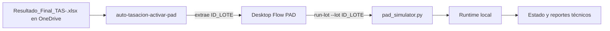

# Evidencia E2E: Cloud Flow a PAD en simulación

**Fecha:** 2026-10-13
**Estado:** validado en modo `SIMULACION`

## Alcance comprobado

Se comprobó el recorrido que comienza cuando Power Automate entrega un Excel
final en OneDrive y termina con el procesamiento local y trazable de ese lote
por Power Automate Desktop (PAD):



La prueba produjo un Excel final nuevo, activó correctamente el flujo Cloud y
este inició el Desktop Flow. El simulador terminó el lote con el estado
`SIMULADO_FINALIZADO`.

| Comprobación | Resultado observado |
| --- | --- |
| Intentos | 1 |
| Operaciones simuladas | 1 |
| Revisiones manuales | 0 |
| Revisiones de IA | 0 |
| Errores técnicos | Ninguno |
| Acción Cloud de PAD | Correcta |

Esta evidencia cubre únicamente la simulación. No ejecuta una macro, VBA,
Excel interactivo, PCOMM, IBM 3270 ni una operación bancaria real.

## Configuración operativa validada

### Cloud Flow `auto-tasacion-activar-pad`

El flujo se activa con **Cuando se crea un archivo (solo propiedades)** de
OneDrive para la Empresa sobre la raíz lógica de resultados
`/automatizaciones-jhglazar/auto-tasaciones`.

- No incluye subcarpetas.
- Revisa como máximo diez archivos por sondeo y opera con el intervalo del
  conector configurado en un minuto.
- Se divide una ejecución por archivo y limita la simultaneidad a una ejecución.
- Solo acepta el patrón `Resultado_Final_TAS-<ID_LOTE>.xlsx` mediante la
  condición de desencadenador:

  ```text
  @and(startsWith(triggerBody()?['Name'], 'Resultado_Final_TAS-'), endsWith(triggerBody()?['Name'], '.xlsx'))
  ```

- Ejecuta el Desktop Flow en modo atendido y entrega exclusivamente `IdLote`.
- Deriva el valor de entrada a partir del nombre del archivo:

  ```text
  @replace(replace(triggerBody()?['Name'], 'Resultado_Final_', ''), '.xlsx', '')
  ```

El identificador físico de carpeta, las referencias de conexión y los
identificadores de componentes se administran en Power Platform; no se guardan
en este repositorio.

### Desktop Flow `auto-tasacion-procesar-3270-simulado`

El flujo PAD publicado recibe una variable de entrada requerida de texto con
nombre externo `IdLote`. `Main` llama solamente a `InicializarLote` y a
`ValidarExcel`.

`ValidarExcel` inicia el intérprete local con el comando lógico siguiente:

```text
pad_simulator.py --config "%RutaConfiguracion%" run-lot --lot "%IdLote%"
```

`PrepararRegistros` se conserva para diagnóstico manual y no se llama desde
`Main`: procesa pendientes de forma global y no es válido para la activación
por evento de un lote concreto.

## Garantías comprobadas

- `run-lot` espera únicamente el Excel del lote recibido. No recorre otros
  archivos ni pendientes.
- Espera la sincronización local de OneDrive hasta
  `input_sync_timeout_seconds` (600 segundos por defecto) y exige estabilidad
  del archivo antes de procesarlo.
- La clave durable `(id_lote, SHA-256)` evita operaciones duplicadas ante
  reintentos o eventos duplicados.
- El Excel de origen no se modifica.
- El runtime ya tenía disponibles `estado`, `resultados`, `logs` y `errores`
  antes de la ejecución.

## Evidencia local y diagnóstico

El runtime es local al equipo de ejecución y queda fuera de OneDrive. Después
de una ejecución satisfactoria se deben encontrar, bajo `runtime_directory`:

```text
estado/lotes/<ID_LOTE>.json
estado/procesados/<ID_LOTE>.json
resultados/<ID_LOTE>_operaciones.csv
resultados/<ID_LOTE>_resumen.json
resultados/<ID_LOTE>_validacion.json
```

Mantener el runtime local evita conflictos de sincronización sobre locks,
estados y logs. Si se requiere compartir resultados más adelante, se debe
publicar una copia explícita de los reportes finales a una carpeta dedicada de
OneDrive. No se deben mover `estado`, `logs`, locks ni trabajos a OneDrive.

Para diagnosticar una nueva incidencia, revise en este orden:

1. Historial de `auto-tasacion-activar-pad`: creación detectada, condición del
   nombre y resultado de la acción PAD.
2. Sincronización local del Excel concreto en el equipo BPO.
3. Estado del lote bajo `estado/lotes/`.
4. Reportes en `resultados/` y diagnóstico técnico en `logs/` o `errores/`.

`ESPERA_SINCRONIZACION_AGOTADA` indica que el archivo concreto no estuvo
disponible y estable dentro del tiempo configurado. Se corrige la
sincronización del archivo; no se debe sustituir por un escaneo global.

## Límite actual y siguiente cambio autorizado

La integración automática Cloud → PAD está comprobada en simulación hasta la
generación de estado y reportes locales. La transición hacia macro, Excel
interactivo o IBM 3270 requiere una autorización, diseño y validación E2E
separados. Cualquier publicación futura de reportes a OneDrive debe conservar
la idempotencia por lote y no debe compartir el runtime técnico.
