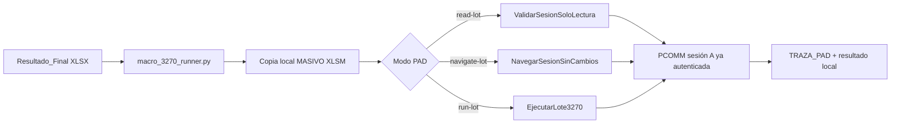

# Ejecución final PAD: Resultado_Final -> MASIVO -> PCOMM 3270

**Fecha:** 2026-10-14
**Estado:** preparación de Excel y mapeo confirmados en BPO. La primera prueba
atendida será de solo lectura; la ejecución transaccional requiere una decisión
posterior y explícita.

## Alcance de este tramo

La ruta final conserva el Excel entregado por Cloud y trabaja sobre una copia
local de una plantilla `.xlsm` aprobada:



Solo se cargan las filas de `PARA_PROCESAR`. `REVISION_IA` queda excluida de
la macro y se conserva en el `Resultado_Final` original para atenderla después.

El adaptador mantiene la columna `Y` para el resultado de PCOMM. Crea una hoja
`TRAZA_PAD` con lote, `ID_CASO`, préstamo, estado, resultado y fechas. No se
altera el XLSX de OneDrive ni la plantilla maestra.

## Mapeo aplicado

| Cloud `PARA_PROCESAR` | `MASIVO` | Tratamiento |
| --- | --- | --- |
| `PRESTAMO` | `A` | Texto de 20 dígitos. |
| `TIPO DE INMUEBLE` | `B` | Entrada para la fórmula de `C`. |
| `MONEDA`, `IMPORTE` | `D:E` | Importe convertido a número. |
| `DIRECCION`, `DIRECCION1`, `EXTERIOR`, `INTERIOR`, `REFERENCIA` | `F`, `H:K` | Datos de domicilio. |
| `UBICACION`, `UBICACION1`, `MUNICIPIO` | `L`, `N:O` | Datos territoriales legibles. |
| `DIST_COD`, `PROV_COD`, `DEPT_COD` | `P`, `R`, `T` | Códigos ya validados por Cloud. |
| `PISOS`, `SOTANOS`, `AÑO` | `V:X` | Entradas para el envío a 3270. |
| Fórmulas de plantilla | `C`, `G`, `M`, `U` | Se conservan y Excel las recalcula. |
| `ID_CASO` | `TRAZA_PAD` | Nunca se escribe en `Y`. |

## Componentes versionados

- `macro_3270_runner.py`: prepara una copia local, la llena por contrato,
  invoca Excel y llama el módulo VBA. Mantiene estado independiente en
  `estado\\macro_3270` para que un evento duplicado no ejecute 3270 dos veces.
- `vba\\AutoTasacion3270.bas`: contiene tres procedimientos con alcances
  separados:
  `ValidarSesionSoloLectura`, que únicamente se adjunta a PCOMM y lee un
  carácter de pantalla; `NavegarSesionSinCambios`, que abre I003 sin utilizar
  datos de la fila ni cambiar el centro; y `EjecutarLote3270`, que es el
  procedimiento transaccional histórico. Los tres registran resultado
  estructurado en `TRAZA_PAD`.
- `config.macro-3270.example.json`: configuración de producción a copiar como
  `config.macro-3270.local.json`.
- `requirements-macro-3270.txt`: dependencia de Excel COM (`pywin32`).

## Preparación única en BPO

Estas acciones se realizan una vez antes de modificar PAD:

1. Cree estas carpetas sincronizadas:

   ```text
   C:\Users\mailbox_27530\OneDrive - NTT DATA EMEAL\automatizaciones-jhglazar\auto-tasaciones\codigos\plantillas
   C:\Users\mailbox_27530\OneDrive - NTT DATA EMEAL\automatizaciones-jhglazar\auto-tasaciones\Procesados
   ```

2. Copie `excel-procesado-listo-para-pasar-macro.xlsm` a `codigos\\plantillas`
   con el nombre `Plantilla_MASIVO_AUTO_3270.xlsm`.

3. Abra **esa copia** con Excel. Presione `Alt+F11`, elija **Archivo → Importar
   archivo** e importe `power-platform\\pad\\vba\\AutoTasacion3270.bas`. Guarde
   el libro como `.xlsm` y ciérrelo. La primera prueba invocará
   `AutoTasacion3270.ValidarSesionSoloLectura`; no escribe ni envía teclas a
   PCOMM.

4. Instale la dependencia en el mismo Python que usa PAD:

   ```powershell
   & "C:\Users\mailbox_27530\AppData\Local\NTT DATA EMEAL\auto-tasacion\python-env\Scripts\python.exe" -m pip install -r "C:\Users\mailbox_27530\OneDrive - NTT DATA EMEAL\automatizaciones-jhglazar\auto-tasaciones\codigos\pad-simulation\auto-tasacion\power-platform\pad\requirements-macro-3270.txt"
   ```

5. Copie `config.macro-3270.example.json` como `config.macro-3270.local.json`
   en `power-platform\\pad` y confirme las rutas. Este archivo es local y no se
   incorpora a Git.

6. En Excel, agregue la carpeta local de trabajo como ubicación de confianza:

   ```text
   C:\ProgramData\NTT DATA EMEAL\auto-tasacion\pad-runtime\trabajo
   ```

   La plantilla se conserva fuera de esa ruta; cada lote crea una copia nueva
   dentro de ella.

## Cambio concreto en Power Automate Desktop

En el Desktop Flow ya conectado al Cloud Flow, mantenga la entrada `IdLote`.
En el subflujo `ValidarExcel`, reemplace el comando de simulación por esta
acción **Ejecutar aplicación**, esperando a que finalice:

**Aplicación**

```text
C:\Windows\System32\cmd.exe
```

**Argumentos para la prueba segura de solo lectura**

```text
/d /c ""C:\Users\mailbox_27530\AppData\Local\NTT DATA EMEAL\auto-tasacion\python-env\Scripts\python.exe" "C:\Users\mailbox_27530\OneDrive - NTT DATA EMEAL\automatizaciones-jhglazar\auto-tasaciones\codigos\pad-simulation\auto-tasacion\power-platform\pad\macro_3270_runner.py" --config "%RutaConfiguracion%" read-lot --lot "%IdLote%""
```

`RutaConfiguracion` conserva la ruta completa del archivo
`config.macro-3270.local.json`. El envoltorio `cmd.exe` es necesario porque
PAD no resolvió directamente el ejecutable Python cuya ruta contiene espacios.
Conserve `Main` como `InicializarLote` seguido de `ValidarExcel`. Publique el
Desktop Flow después de guardar.

Para la ejecución transaccional aprobada posteriormente, cambie únicamente
`navigate-lot` por `run-lot`. El modo intermedio `navigate-lot` se usa para una
demostración visible: solo ejecuta `PAUSA`, escribe `I003` en la línea de
comandos y presiona `ENTER`. Lee el centro de la pantalla y deja la sesión en
I003. Si el centro no es `0727`, registra
`NAVEGADO_SIN_CAMBIOS_3270_CON_INCIDENCIAS`; no ejecuta `QGTR` ni cambia el
centro. `run-lot` escribe y navega con datos de negocio y no forma parte de
esta prueba.

## Primera ejecución de presentación: solo lectura

1. Abra PCOMM en BPO, autentíquese y deje la sesión **A** en la pantalla de
   espera indicada en `login.png`.
2. Inicie el lote desde Canvas como en la prueba de diez PDFs.
3. Cuando el Cloud Flow cree `Resultado_Final_TAS-<LOTE>.xlsx`, el flujo ya
   existente llamará PAD con `IdLote`.
4. PAD creará el libro local, verificará que la sesión A permite lectura y
   registrará `LECTURA_3270_OK` por cada fila. No escribe campos, no envía
   teclas, no navega en 3270 ni procesa préstamos. El libro queda en:

   ```text
   C:\ProgramData\NTT DATA EMEAL\auto-tasacion\pad-runtime\trabajo\<LOTE>_<SHA>\Resultado_MASIVO_<LOTE>.xlsm
   ```

   El resultado del lote queda en
   `resultados\\<LOTE>_<SHA>_macro_3270.json`. También publicará la copia
   `.xlsm` terminada a `Procesados` si la ruta configurada está disponible.

5. Un segundo evento de lectura vuelve a validar la disponibilidad de sesión
   sin afectar el host. La idempotencia de `run-lot` protege exclusivamente la
   futura ejecución transaccional.

## Evidencia E2E confirmada

El 2026-10-14 se ejecutó un lote nuevo de diez PDFs de prueba, con identidades
de OneDrive nuevas para no reutilizar el lote anterior. La API de Cloud Run
confirmó los siguientes valores públicos:

| Campo | Valor |
| --- | --- |
| `id_lote` | `TAS-F1C48BE414207A139FF0` |
| Estado Cloud | `ENTREGADO` |
| PDFs cargados / procesados / fallidos | `10 / 10 / 0` |
| Duración Cloud | 130 segundos |

El Desktop Flow publicado ejecutó `read-lot` en BPO. El estado durable de PAD
confirmó `VALIDADO_LECTURA_3270`, `modo_ejecucion = SOLO_LECTURA`, cuatro filas
de `PARA_PROCESAR` y `LECTURA_3270_OK` con `SESION_A_LEIBLE` en cada una. No
hubo `technical_error` y el libro publicado fue:

```text
C:\Users\mailbox_27530\OneDrive - NTT DATA EMEAL\automatizaciones-jhglazar\auto-tasaciones\Procesados\Resultado_MASIVO_TAS-F1C48BE414207A139FF0.xlsm
```

Esta evidencia cierra el tramo Cloud → resultado Excel → PAD → plantilla MASIVO
→ lectura de PCOMM. Aún no constituye una ejecución transaccional contra 3270;
esa fase requiere reemplazar `read-lot` por `run-lot` después de su aprobación.
