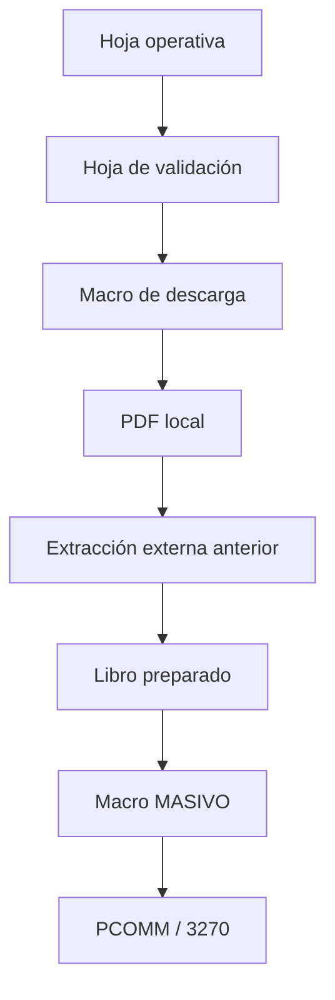
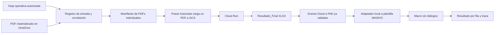

# Flujo operador → Cloud → plantilla MASIVO → 3270

**Fecha:** 2026-10-14
**Estado:** contrato Cloud implementado localmente; pendiente publicar el
cambio de Cloud Run y aplicar la configuración manual de Canvas

## Propósito

Este documento corrige el origen de los datos que requiere el tramo final. El
préstamo no se obtiene del PDF ni se consulta en 3270: llega en la hoja que el
operador recibe para atender el lote. El PDF aporta la tasación y el flujo debe
conservar ambas fuentes hasta preparar la plantilla `MASIVO`.

No se registran aquí identificadores de clientes, vínculos de descarga,
documentos, credenciales ni datos de una operación real.

## Entrada del operador

Cada fila de la hoja operativa contiene como mínimo:

| Campo | Uso propuesto |
| --- | --- |
| `SEGURO` | Referencia de la operación. Se conserva en traza restringida; no ocupa `MASIVO!Y`, que es salida de la macro. |
| `PRESTAMO` | Identificador autorizado de 20 caracteres. Alimenta `MASIVO!A` después de validación. |
| `DNI` | Dato de trazabilidad restringida. No es necesario para la cola de la macro final. |
| `NOMBRE_CLIENTE` | Dato de trazabilidad restringida. No es necesario para la cola de la macro final. |
| `NRO_EXPEDIENTE` | Referencia de conciliación restringida. |
| `MONEDA` | Dato de origen que debe compararse con la moneda extraída del PDF. Una discrepancia se reporta, no se resuelve silenciosamente. |
| Enlace de tasación | Referencia desde la que se materializa el PDF mediante un mecanismo autorizado. No se transporta como URL en el manifiesto de Cloud Run. |

La relación se formaliza con una proyección de control que contiene
`ID_INGRESO` y `ARCHIVO_PDF`. La proyección no incorpora DNI, nombre de cliente
ni el enlace externo de tasación. Su contrato se mantiene en
[`../../contracts/control-lote.md`](../../contracts/control-lote.md).

## Evidencia del conjunto histórico de diez casos

Se inspeccionó en modo lectura el conjunto de diez PDFs y su libro final ya
procesado. No se abrió Excel, no se ejecutó VBA, no se modificó ningún PDF y no
se registraron valores de clientes.

El libro contiene diez filas activas en `MASIVO` y las diez cumplen el formato
de 20 caracteres en `PRESTAMO`. Las columnas que producen códigos de catálogo
mantienen sus fórmulas. Las diez filas tienen un valor en `SEGURO INMUEBLE`, lo
que confirma que es un ejemplo válido del contrato de salida de la macro.

`N. INTERIOR` no está cargado en ese conjunto y `UBICACIÓN` / `UBICACIÓN 1`
solo aparecen en parte de las filas. Dado que la macro completó el conjunto, no
se deben convertir esos tres campos en bloqueos universales sin una regla de
negocio posterior.

El libro no contiene `ID_CASO`, nombre de PDF, vínculo de descarga, expediente,
DNI ni nombre de cliente. Los PDFs tienen nombres genéricos. Por tanto, el
conjunto prueba el formato final, pero no permite reconstruir por sí solo la
relación entre una fila operativa y su PDF de origen.

## Correlación mínima para el flujo nuevo

Mientras el operador continúe descargando los PDFs antes de iniciar Power Apps,
la entrada debe incluir un control de lote junto con esos archivos. La hoja se
guarda en `ControlEntrada`, nunca en `Controles`, que queda reservada para los
JSON que activan el orquestador:

1. Power Apps recibe una proyección de la hoja operativa con un `ID_INGRESO`
   técnico y un `ARCHIVO_PDF` por fila.
2. Cada PDF se carga en `PDFs` y `ARCHIVO_PDF` se compara con su nombre. El
   código no deriva la asociación por posición de fila, nombre de cliente ni
   enlace externo. El nombre puede ser técnico, por ejemplo `D01.pdf`.
3. Antes de crear el manifiesto, una prevalidación exige una fila y un PDF por
   cada `ID_INGRESO`, sin duplicados. Luego relaciona el `item_id` del PDF con
   esa referencia técnica.
4. El manifiesto lleva solo `ID_INGRESO`, `PRESTAMO`, moneda y referencias de
   conciliación autorizadas. DNI, nombre de cliente y enlace quedan fuera de la
   aplicación y del manifiesto.

La alternativa de usar `SEGURO` o `NRO_EXPEDIENTE` como llave requiere
demostrar que el campo es único, estable y siempre está presente. Hasta esa
confirmación, `ID_INGRESO` evita depender de identificadores de negocio.

## Flujo histórico observado

La macro histórica de validación usa la hoja activa con enlaces y seguros. Sus
rutinas descargan PDFs por automatización de navegador y una de ellas consulta
una dirección mediante PCOMM usando el seguro. Trabaja con selección de filas,
diálogos y rutas locales, por lo que es referencia funcional, pero no un
componente reutilizable directamente por Cloud ni por PAD desatendido.

La inspección del VBA no encontró una invocación a `python`, `pdf_extractor.py`
ni a otro script de Python. Por tanto, la extracción que antes se realizaba en
Colab fue un paso externo a ese libro. Si existía otro script de preparación,
debe incorporarse como evidencia separada antes de reproducir su comportamiento.

## Flujo objetivo

1. Un proceso autorizado materializa cada PDF referenciado por la fila
   operativa en la carpeta de entrada de OneDrive. El diseño vigente no admite
   enlaces externos en el manifiesto: solo declara `item_id`, `etag`, nombre y
   tamaño de un PDF ya presente.
2. La capa de entrada crea una relación estable por `ARCHIVO_PDF`, conserva
   DNI, nombre de cliente y enlace fuera de la cola bancaria y asocia
   `ID_INGRESO` con el futuro `ID_CASO`.
3. El flujo actual procesa un PDF por vez. `service.py` invoca
   `pdf_extractor.py`; `address_parser.py` y `catalog.py` normalizan dirección,
   territorio y códigos. Esa combinación reemplaza la etapa externa anterior
   de extracción, sin descargar enlaces públicos desde Cloud Run.
4. Cloud une el resultado extraído con la metadata de entrada. `PRESTAMO` pasa
   validado a `PARA_PROCESAR`; la moneda de origen se concilia con la moneda
   documentada; DNI, nombre y enlace no llegan a Cloud.
5. El resultado Cloud activa PAD, integración ya comprobada solamente en
   `SIMULACION`.
6. PAD conserva el XLSX original, crea una copia local de la plantilla `.xlsm`
   y llena `MASIVO` por encabezados. `ID_CASO`, `ID_LOTE`, seguro de origen,
   estado y errores se guardan fuera de `A:Y`, por ejemplo en `TRAZA_PAD`.
7. La macro final recibe una sesión de terminal ya preparada como precondición,
   procesa filas no bloqueadas y produce un resultado estructurado por fila.

## Contrato para la plantilla final

`excel-procesado-listo-para-pasar-macro.xlsm` usa `MASIVO!A:Y` y exige
`PRESTAMO` en `A`. La macro `segHipoMasiv` devuelve el seguro o un texto de
pantalla en `Y`. Por ello los datos se dividen así:

| Destino | Contenido |
| --- | --- |
| `MASIVO!A` | Préstamo validado de la fila operativa. |
| `MASIVO!B:X` | Resultado Cloud normalizado y fórmulas de catálogos de la plantilla. |
| `MASIVO!Y` | Solo resultado de la macro final. |
| `TRAZA_PAD` / `CONTROL` restringido | `ID_CASO`, lote, seguro de origen, expediente, DNI, cliente, conciliaciones y errores. |

La plantilla actual debe refactorizarse antes de invocarla desde PAD: seleccionar
filas sin `InputBox`, calificar las referencias a `MASIVO`, leer el tipo por
fila y reemplazar las rutas fijas de capturas por el runtime del lote.

## Brechas para implementar, en orden

1. Publicar el cambio Cloud Run y aplicar en Canvas la colección
   `tblControlLote` documentada en el contrato.
2. Confirmar con una prueba de control que las diez relaciones
   `ARCHIVO_PDF`–PDF y sus préstamos son únicas.
3. Promover las reglas aclaradas de negocio a código con casos sintéticos.
4. Crear el adaptador local que copie y llene una plantilla `.xlsm` aprobada,
   sin alterar el resultado Cloud ni la plantilla maestra.
5. Refactorizar y versionar la macro para ejecución no interactiva y salida
   estructurada por fila.
6. Solo tras las validaciones anteriores, realizar una prueba aislada con
   sesión PCOMM preparada y datos autorizados.

Hasta el punto 5, no se ejecutan VBA, PCOMM ni IBM 3270. El alcance comprobado
sigue siendo Cloud → PAD en simulación.
