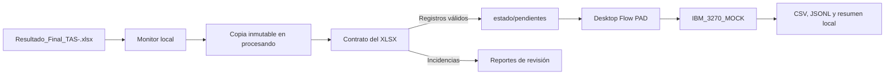

# Piloto local PAD: tasaciones y 3270 simulado

Este directorio prepara el paso posterior a `Resultado_Final_<ID_LOTE>.xlsx`.
El piloto es local y funciona únicamente en modo `SIMULACION`: no abre Excel,
no ejecuta VBA, no abre PCOMM ni IBM Personal Communications, y no inicia una
sesión 3270 bancaria.

La simulación deja operaciones `ALTA_SEGURO_INMUEBLE_SIMULADA` con destino
`IBM_3270_MOCK`. Las automatizaciones Power Apps, Power Automate Cloud, GCS y
Cloud Run no forman parte de esta implementación y no se modifican.

## Alcance y recorrido



El monitor analiza solo archivos `.xlsx` en el nivel superior de la carpeta de
entrada. Por ello nunca toma como entrada los artefactos de
`_pad_3270_simulado/`. Ignora archivos temporales de Excel (`~$`) y nombres que
no sigan exactamente este patrón:

```text
Resultado_Final_TAS-<ID_LOTE>.xlsx
```

La configuración de desarrollo apunta a:

```text
C:\Users\jhglazar\OneDrive - NTT DATA EMEAL\Escritorio\tasaciones
```

Los originales no se cambian. Antes de validar se exige estabilidad de tamaño y
fecha de modificación en tres lecturas; luego se calcula SHA-256 y se copia a
`procesando/<ID_LOTE>/<SHA>.xlsx`.

## Contrato del Excel

El código carga el contrato de [tools/verify_workbook.py](../../tools/verify_workbook.py):

- hojas exactas y ordenadas: `PARA_PROCESAR`, `REVISION_IA`, `CONTROL`;
- tablas `tblParaProcesar`, `tblRevisionIa` y `tblControl`;
- encabezados y orden exactos de `tblParaProcesar`;
- `PRESTAMO` puede estar vacío; no se completa ni se modifica;
- solo `PARA_PROCESAR` genera operaciones simuladas;
- las filas de `REVISION_IA` se cuentan y quedan fuera de la simulación.

Cada fila de `PARA_PROCESAR` queda clasificada como:

- `REGISTRO_VALIDO`: se crea una operación simulada.
- `REVISION_MANUAL`: faltan campos obligatorios, hay un formato inválido o una
  alerta de plausibilidad. No se inventan ni corrigen valores.
- `ERROR_ESTRUCTURAL`: el archivo no abre o rompe el contrato de hojas, tablas
  o encabezados.

Las validaciones de negocio se limitan al contrato existente, formato de
importe, moneda `PEN`/`USD`, enteros no negativos de pisos/sótanos y año entre
1900 y el año actual. No se aplica ninguna regla adicional de la macro VBA.

## Estados e idempotencia

La clave de idempotencia es `(id_lote, SHA-256)`, persistida bajo
`estado/lotes/`. Se usa un bloqueo atómico por lote antes de registrar o
reclamar trabajo.

```text
DETECTADO → VALIDANDO → VALIDADO → SIMULANDO_3270 → SIMULADO_FINALIZADO
                                                   ↘ SIMULADO_CON_INCIDENCIAS
                    ↘ REVISION_MANUAL
                    ↘ ERROR_ESTRUCTURAL / ERROR_TECNICO / ERROR_ORIGEN_CAMBIO
```

- El mismo archivo no crea un segundo estado, trabajo ni reporte operativo.
- El mismo `ID_LOTE` con otro SHA queda en `ERROR_ORIGEN_CAMBIO`.
- Un segundo intento de ejecutar un trabajo ya terminal no realiza operaciones.
- Una reserva que excede `processing_lease_seconds` se recupera conservando la
  bitácora del intento anterior.
- `reprocess` es una acción explícita, exige un lote terminal y archiva el
  estado anterior antes de crear un nuevo trabajo.

## Preparar y probar localmente

Desde la raíz del repositorio:

```powershell
py -3.13 -m venv power-platform/pad/.venv
power-platform/pad/.venv/Scripts/python.exe -m pip install -r power-platform/pad/requirements.txt
./power-platform/pad/Test-PadSimulation.ps1
```

Para ejecutar el detector una sola vez y ver resultados en consola:

```powershell
power-platform/pad/.venv/Scripts/python.exe power-platform/pad/pad_simulator.py --config power-platform/pad/config.development.json monitor --once
```

Para iniciarlo continuamente fuera de PAD:

```powershell
./power-platform/pad/Start-PadSimulationMonitor.ps1
./power-platform/pad/Stop-PadSimulationMonitor.ps1
```

El flujo de escritorio se documenta en
[MANUAL_SOLUTION_INTEGRATION.md](MANUAL_SOLUTION_INTEGRATION.md). La creación
del componente PAD dentro de la solución sigue siendo una acción manual y no
queda declarada como completada hasta verlo en `autoTasacion`.

## Salidas locales

Todo se guarda bajo `_pad_3270_simulado/`, fuera del conjunto de entrada:

- `procesando/`: copia inmutable del XLSX por SHA;
- `estado/lotes/`: estado durable y eventos de cada lote;
- `estado/pendientes/`: trabajos que debe consumir PAD;
- `estado/procesados/`: trabajos consumidos;
- `resultados/`: reporte de validación, CSV de operaciones y resumen JSON;
- `logs/`: JSONL técnico sin direcciones, importes ni datos del predio;
- `errores/`: trabajos que terminaron con error técnico.

No se producen resultados bancarios ni cambios sobre el XLSX de origen.
