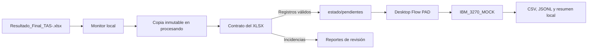

# Piloto local PAD: tasaciones y 3270 simulado

Este directorio prepara el paso posterior a `Resultado_Final_<ID_LOTE>.xlsx`.
El piloto es local y funciona únicamente en modo `SIMULACION`: no abre Excel,
no ejecuta VBA, no abre PCOMM ni IBM Personal Communications, y no inicia una
sesión 3270 bancaria.

La simulación deja operaciones `ALTA_SEGURO_INMUEBLE_SIMULADA` con destino
`IBM_3270_MOCK`. Las automatizaciones Power Apps, Power Automate Cloud, GCS y
Cloud Run no forman parte de esta implementación y no se modifican.

## Alcance y recorrido



El monitor analiza solo archivos `.xlsx` en el nivel superior de la carpeta de
entrada. Por ello nunca toma como entrada los artefactos de
`_pad_3270_simulado/`. Ignora archivos temporales de Excel (`~$`) y nombres que
no sigan exactamente este patrón:

```text
Resultado_Final_TAS-<ID_LOTE>.xlsx
```

Las rutas de entrada, instalación y runtime se declaran por perfil en
[`../../config/automation-locations.json`](../../config/automation-locations.json).
`config.development.json` y `config.production.example.json` resuelven sus
rutas mediante esos perfiles. El runtime de desarrollo queda bajo
`%LOCALAPPDATA%`, fuera de OneDrive; el de NTTD-MKEY queda en
`C:\ProgramData`.

Los originales no se cambian. Antes de validar se exige estabilidad de tamaño y
fecha de modificación en tres lecturas; luego se calcula SHA-256 y se copia a
`procesando/<ID_LOTE>/<SHA>.xlsx`.

## Contrato del Excel

El código carga el contrato de [tools/verify_workbook.py](../../tools/verify_workbook.py):

- hojas exactas y ordenadas: `PARA_PROCESAR`, `REVISION_IA`, `CONTROL`;
- tablas `tblParaProcesar`, `tblRevisionIa` y `tblControl`;
- encabezados y orden exactos de `tblParaProcesar`;
- `PRESTAMO` puede estar vacío; no se completa ni se modifica;
- solo `PARA_PROCESAR` genera operaciones simuladas;
- las filas de `REVISION_IA` se cuentan y quedan fuera de la simulación.

Cada fila de `PARA_PROCESAR` queda clasificada como:

- `REGISTRO_VALIDO`: se crea una operación simulada.
- `REVISION_MANUAL`: faltan campos obligatorios, hay un formato inválido o una
  alerta de plausibilidad. No se inventan ni corrigen valores.
- `ERROR_ESTRUCTURAL`: el archivo no abre o rompe el contrato de hojas, tablas
  o encabezados.

Las validaciones de negocio se limitan al contrato existente, formato de
importe, moneda `PEN`/`USD`, enteros no negativos de pisos/sótanos y año entre
1900 y el año actual. No se aplica ninguna regla adicional de la macro VBA.

## Estados e idempotencia

La clave de idempotencia es `(id_lote, SHA-256)`, persistida bajo
`estado/lotes/`. Se usa un bloqueo atómico por lote antes de registrar o
reclamar trabajo.

```text
DETECTADO → VALIDANDO → VALIDADO → SIMULANDO_3270 → SIMULADO_FINALIZADO
                                                   ↘ SIMULADO_CON_INCIDENCIAS
                    ↘ REVISION_MANUAL
                    ↘ ERROR_ESTRUCTURAL / ERROR_TECNICO / ERROR_ORIGEN_CAMBIO
```

- El mismo archivo no crea un segundo estado, trabajo ni reporte operativo.
- El mismo `ID_LOTE` con otro SHA queda en `ERROR_ORIGEN_CAMBIO`.
- Un segundo intento de ejecutar un trabajo ya terminal no realiza operaciones.
- Una reserva que excede `processing_lease_seconds` se recupera conservando la
  bitácora del intento anterior.
- `reprocess` es una acción explícita, exige un lote terminal y archiva el
  estado anterior antes de crear un nuevo trabajo.

## Bloqueos transitorios y diagnóstico técnico

El runtime está fuera de la carpeta compartida de OneDrive. Aun así, Windows u
otro proceso local puede retener brevemente un JSON, CSV o trabajo. Las
operaciones de reemplazo atómico, escritura JSONL y movimiento de trabajos
tienen cinco intentos por defecto con espera exponencial de 0.1, 0.2, 0.4 y 0.8
segundos entre intentos. Se puede ajustar con
`file_retry_attempts` y `file_retry_base_seconds` en la configuración.

Las operaciones simuladas se agregan a la bitácora y al estado en un único lote
por ejecución, en lugar de reescribir el JSON de estado por cada fila. Si los
reintentos se agotan, el estado registra `technical_diagnostic` con:

- tipo del error;
- operación de almacenamiento;
- ruta relativa dentro del runtime;
- número de intentos;
- traceback técnico sin valores del predio ni datos bancarios.

Si la simulación ya llegó a un estado terminal y solo falla el archivado del
trabajo o de la evidencia, el estado terminal se conserva y se registra una
advertencia de posprocesamiento; nunca se relanza el lote automáticamente.
Cada reproceso explícito usa un nuevo identificador de ejecución, por lo que no
sobrescribe CSV o JSON de un intento anterior.

## Preparar y probar localmente

Desde la raíz del repositorio:

```powershell
py -3.13 -m venv power-platform/pad/.venv
power-platform/pad/.venv/Scripts/python.exe -m pip install -r power-platform/pad/requirements.txt
./power-platform/pad/Test-PadSimulation.ps1
```

Para ejecutar el detector una sola vez y ver resultados en consola:

```powershell
power-platform/pad/.venv/Scripts/python.exe power-platform/pad/pad_simulator.py --config power-platform/pad/config.development.json monitor --once
```

Para que PAD ejecute una sola vuelta sin duplicar las reglas en acciones
visuales, use `run-cycle`. Detecta libros y consume los trabajos pendientes
con la reserva idempotente existente:

```powershell
power-platform/pad/.venv/Scripts/python.exe power-platform/pad/pad_simulator.py --config power-platform/pad/config.development.json run-cycle
```

## Invocación automática por lote desde Cloud Flow

El punto de entrada para la integración Cloud → PAD es `run-lot`. Recibe solo
el identificador que Cloud extrajo de `Resultado_Final_<ID_LOTE>.xlsx` y nunca
recorre los otros Excel o trabajos pendientes:

```powershell
power-platform/pad/.venv/Scripts/python.exe power-platform/pad/pad_simulator.py `
  --config power-platform/pad/config.local.json run-lot --lot TAS-<ID_LOTE>
```

Cuando el evento Cloud llega antes que OneDrive sincronice el libro en la PC
BPO, `run-lot` espera únicamente ese archivo durante
`input_sync_timeout_seconds` (600 segundos por defecto) y exige la misma
comprobación de estabilidad de tamaño y fecha antes de copiarlo. Si se agota
el plazo, devuelve `ESPERA_SINCRONIZACION_AGOTADA` y falla; no escanea ni
procesa otro lote.

La reserva durable `(id_lote, SHA-256)` conserva la idempotencia ante eventos
duplicados. Un segundo llamado sobre el mismo Excel devuelve el estado terminal
sin crear operaciones simuladas adicionales.

Para conectarlo al Desktop Flow, declare en PAD una variable de entrada de
texto llamada `IdLote` y haga que la acción **Ejecutar aplicación** ejecute
`run-lot --lot "%IdLote%"`. El subflujo `PrepararRegistros` no debe seguirse
invocando desde `Main`, porque su recorrido por `pendientes` es global y se
conserva solo como herramienta de diagnóstico manual.

Para iniciarlo continuamente fuera de PAD:

```powershell
./power-platform/pad/Start-PadSimulationMonitor.ps1
./power-platform/pad/Stop-PadSimulationMonitor.ps1
```

El flujo de escritorio se documenta en
[MANUAL_SOLUTION_INTEGRATION.md](MANUAL_SOLUTION_INTEGRATION.md). La creación
manual del componente PAD, su publicación y el recorrido automático Cloud →
PAD por `IdLote` fueron comprobados el 2026-10-13 en `SIMULACION`. La evidencia
operativa, sus límites y el diagnóstico están en
[`../../docs/operacion/e2e-cloud-pad-simulacion-2026-10-13.md`](../../docs/operacion/e2e-cloud-pad-simulacion-2026-10-13.md).

## Salidas locales

Todo se guarda bajo el `runtime_directory` local configurado, fuera del
OneDrive compartido y del conjunto de entrada:

- `procesando/`: copia inmutable del XLSX por SHA;
- `estado/lotes/`: estado durable y eventos de cada lote;
- `estado/pendientes/`: trabajos que debe consumir PAD;
- `estado/procesados/`: trabajos consumidos;
- `resultados/`: reporte de validación, CSV de operaciones y resumen JSON;
- `logs/`: JSONL técnico sin direcciones, importes ni datos del predio;
- `errores/`: trabajos que terminaron con error técnico.

No se producen resultados bancarios ni cambios sobre el XLSX de origen.

## Ejecución real mediante macro y 3270

Para el tramo de presentación `Resultado_Final → MASIVO → PCOMM`, use
`macro_3270_runner.py` y la plantilla local preparada. La prueba segura usa
`read-lot`, que llama `AutoTasacion3270.ValidarSesionSoloLectura`: solo se
adjunta a la sesión y se lee un carácter de pantalla, sin enviar teclas ni
escribir datos. `navigate-lot` llama `AutoTasacion3270.NavegarSesionSinCambios`:
envía únicamente `PAUSA`, `I003` y `ENTER`, verifica que el centro sea `0727` y
deja visible la pantalla I003. No escribe préstamo, seguro ni ningún campo de
negocio, y no cambia el centro de trabajo. `run-lot` llama
`AutoTasacion3270.EjecutarLote3270` y es el modo transaccional que se habilita
únicamente después de aprobar la prueba de navegación. El procedimiento de
instalación de la plantilla, configuración de PAD y ubicación de resultados está en
[`../../docs/operacion/ejecucion-macro-3270-pad-2026-10-14.md`](../../docs/operacion/ejecucion-macro-3270-pad-2026-10-14.md).

El simulador se conserva para diagnóstico y para lotes anteriores. El Desktop
Flow de presentación debe invocar el ejecutor de macro, no `pad_simulator.py`.
